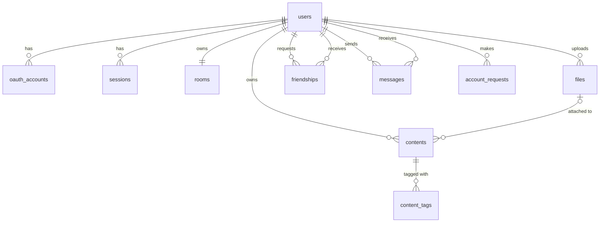

# Database schema (MVP)

Sources: the data model sketch in `ft_transcendence Architecture and Tech Stack Proposal-1.pdf` ("the proposal"), adjusted to our MVP scope, and the module plan in [modules_and_workload.md](modules_and_workload.md).

Assumptions:
- **Fixed room, no placeable objects.** The room is an illustration with fixed hotspots. Users add contents but never position them.
- **PostgreSQL**, as in the proposal. The ORM and the stack (React + NestJS, TypeScript) are still a working hypothesis.
- **Modules in the plan:** the 14-point plan plus the buffer (see `modules_and_workload.md` §4).

## 1. Changes to the proposal's schema

| Proposal table | MVP status | Why |
|---|---|---|
| users, oauth_accounts, sessions | Keep | Unchanged. |
| rooms | Keep, simplified | One per user. Keep owner (unique), slug, title, visibility. Drop `version`: there are no layout saves to protect. |
| catalog_items | Drop | No furniture to place. The hotspots are fixed and defined in frontend config. |
| room_objects | Drop for now | No positions, rotation or scale. It can come back later as a table that points at `contents`, without changing `contents`. |
| contents | Keep, now central | It is exactly what a visitor sees. Gets common columns plus per-type attributes (§4). |
| content_tags (new) | Add | Many-to-many tags, fed by users and by image recognition. |
| account_requests (new) | Add, only with the GDPR buffer module | Confirmation tokens for data export and account deletion. |
| guestbook_entries | Drop | Not required by the subject or our notes, and it adds an endpoint, a UI and moderation rules. Chat, presence and live contents are enough for the real-time module. |
| files, friendships, messages | Keep | Unchanged. |

A hotspot is a frontend config entry: `vinyl player → type "music"`, `bookshelf → type "book"`, and so on. Clicking it calls the API with a type filter (e.g. `GET /api/rooms/:slug/contents?type=book`). A room is therefore the owner's contents plus a visibility setting. Visibility is enforced on every contents and file request.

## 2. Tables needed for the MVP

| Table | Key fields | Relations and rules |
|---|---|---|
| users | id, email (unique), password_hash (nullable), display_name, avatar_file_id (nullable), created_at, last_seen_at (optional) | One room per user, created at sign-up. Email is unique, compared case-insensitively. `password_hash` is Argon2id or bcrypt, never returned by the API and never logged. It is null for accounts that only use OAuth. A null `avatar_file_id` means the default avatar. `users` and `files` reference each other, so make the avatar FK nullable with `ON DELETE SET NULL` and add it after both tables exist. |
| oauth_accounts | id, user_id, provider, provider_user_id, created_at | Unique on (provider, provider_user_id). A user may link several providers. Deleted with the user. |
| sessions | id, user_id, expires_at, created_at | `id` is a long random token (store only its hash). Deleted on logout. Checked on every request and on every WebSocket handshake. Expired rows are purged periodically. |
| rooms | id, owner_id (unique), slug (unique), title, visibility, theme (optional), created_at | `visibility` is public, friends only or private. The slug is the share URL. No `version` column in the MVP. Open decision: can visitors without an account view a public room? |
| contents | id, owner_id, type, title, description, creator, year, rating, file_id (nullable), provider, external_id, source_url, details (JSONB), details_version, created_at, updated_at | `type` is an enum (book, movie, music, meditation, photo, game, painting). `details` is validated against the schema for its `type` (§4). `rating` is 1-5. `file_id` must point to a file owned by the same user. Unique on (owner_id, provider, external_id) when `provider` is not null, so the same movie cannot be added twice. Visibility comes from the owner's room. |
| content_tags | content_id, tag, source, confidence (nullable) | Primary key (content_id, tag). `source` is user or ai. Tags are stored lowercase and trimmed. Deleted with the content. Index on `tag` for search. A user can remove an AI tag. |
| files | id, owner_id, mime_type, size, storage_path, thumbnail_path, checksum, created_at | Type and size are validated on both sides. Stored outside the web root and served only by the backend after an access check that follows the visibility of the room showing it. The file on disk is deleted with its row. Referenced by `contents.file_id` and `users.avatar_file_id`. |
| friendships | id, requester_id, addressee_id, status, created_at | Unique on the unordered pair, so A→B and B→A cannot both exist (e.g. a unique index on the least and greatest of the two ids). `status` is pending or accepted. requester ≠ addressee (check constraint). Accepting runs in a transaction. Either side can remove a friendship, and a pending request can be cancelled or declined by deleting the row. |
| messages | id, sender_id, recipient_id, body, created_at, read_at (nullable) | Direct chat between two users. sender ≠ recipient. Body length is limited. Saved first, then broadcast over the WebSocket. Index on (sender_id, recipient_id, created_at) for history. What happens to messages on account deletion (delete or anonymise) is decided with the GDPR module. |
| account_requests | id, user_id, kind, token_hash, created_at, expires_at, confirmed_at (nullable) | Only needed with the GDPR buffer module. `kind` is export or deletion. The token is single-use, stored hashed, and sent by email. Deletion runs only after confirmation. |

Not stored in the database:
- **Presence and online status** live in memory in the WebSocket hub. `last_seen_at` is optional if you want a "last seen" display.
- **Hotspots** are frontend configuration.
- **Translations** stay in frontend files.

If you add other buffer modules later: 2FA needs a secret per user (columns on `users` or a small table), and a notification system needs a `notifications` table.

Data types (uuid or serial ids, timestamp types, enums) are not set here. Fix them once the ORM is chosen, since the README requires key fields **and** data types.

Relationships at a glance:



## 3. One unified `contents` table

Same conclusion as before: one table, not one per type. All types share ownership, visibility, tags, search and the detail panel, and a single table means one real foreign key target and no `UNION` queries.

## 4. Type-specific attributes (pages for books, medium for paintings)

| Option | How | Verdict |
|---|---|---|
| **A. JSONB column validated per type (recommended)** | A `details` JSONB column holds the type-specific attributes. The app validates it with a schema chosen by `type`. | Flexible, one table, easy to explain. The DB does not enforce the shape, so validation in code is mandatory. |
| B. Sparse nullable columns | `pages`, `medium`, `camera`, ... all on `contents`, `NULL` when not applicable. | Fine for 2-3 attributes. With 7 types the table becomes wide and mostly `NULL`, and it is unclear which columns belong to which type. |
| C. Base table + 1:1 detail tables | `contents` plus `book_details`, `painting_details`, ... | Strictest (typed columns, DB constraints). More tables, joins and migrations for each new type. Switch to this only if constraints in the DB become important. |
| D. Entity-attribute-value | A table of (content, attribute name, value) rows. | Avoid. Queries and validation are painful and it is hard to explain at evaluation. |

**Rule of thumb for what goes where:**
- **Real column** if the attribute applies to most types, or is used to sort, filter or search across all contents. That gives `title`, `description`, `creator` (author, director, artist, photographer, developer), `year`, and the owner's own `rating` (1-5).
- **Tags table** for anything list-like and shared, such as genres and themes. This is also where image recognition writes its labels.
- **`details` JSONB** for the rest, i.e. attributes that only make sense for one or two types.

Suggested attributes per type:

| Type | Shared columns | `details` (type-specific) |
|---|---|---|
| book | title, creator (author), year, rating | pages, isbn, publisher, language |
| movie | title, creator (director), year, rating | runtime_min, language |
| music | title, creator (artist), year, rating | album, duration_sec, kind (track / album / playlist), platform |
| meditation | title, creator (teacher or source), rating | duration_min, technique |
| photo | title, creator (photographer), year, rating | camera, location, taken_at |
| game | title, creator (developer), year, rating | platform, hours_played |
| painting / drawing | title, creator (artist), year, rating | medium, width_cm, height_cm |

External providers fit the same shape: the media integration module stores `provider` and `external_id` in their own columns and normalizes the fetched metadata into the shared columns and `details`.

**Validate with a discriminated union**, so each type has its own allowed attributes (this example uses Zod; check the current docs for the exact API):

```ts
const common = {
  title: z.string().min(1).max(120),
  description: z.string().max(2000).optional(),
  creator: z.string().max(120).optional(),
  year: z.number().int().min(0).max(2100).optional(),
  rating: z.number().int().min(1).max(5).optional(),
};

const book = z.object({
  ...common,
  type: z.literal('book'),
  details: z.object({
    pages: z.number().int().positive().optional(),
    isbn: z.string().optional(),
    publisher: z.string().optional(),
  }).strict(),
});

const painting = z.object({
  ...common,
  type: z.literal('painting'),
  details: z.object({
    medium: z.string().max(60).optional(),
    width_cm: z.number().positive().optional(),
    height_cm: z.number().positive().optional(),
  }).strict(),
});

export const contentInput = z.discriminatedUnion('type', [book, painting /* , movie, ... */]);
```

- **Share the schemas between frontend and backend** in one TypeScript package. This gives the "validation on both sides" requirement from the subject, with one source of truth. `.strict()` rejects unknown keys, so the JSON cannot become a junk drawer.
- **Drive the forms from the same definitions.** A small per-type field config (label, input kind, validation) can generate the "add content" form and the detail panel. Adding an attribute then touches one place.
- **Index on demand.** If search or filters start using a JSON field (e.g. `medium`), PostgreSQL can index it (`details->>'medium'`). If it turns out to be needed everywhere, promote it to a real column.
- **README.** Document `contents` and this per-type attribute table in the Database Schema section, so an evaluator sees a clear schema even though part of it lives in JSON.
