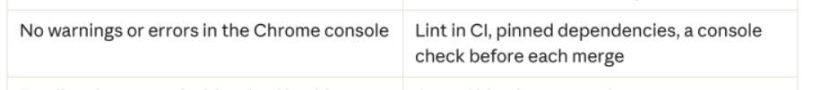
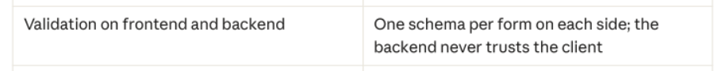

# Questions for experts

What are the most difficult modules to implement ? What are the safest ones ?

# What we build

Subject: "We strongly recommend choosing modules only after your ideas are clear and you have a good understanding of what you want to build."

Idea: a showcase room to share what one likes and / or creates in terms of books, movies, music, meditation, photography, video games and paintings. The user logs in, his showcase room appears (a nice cosy living room in 2D pixel art or isometric 3D or low poly 3D) clicks for example on a vinyl player, and another page appears with a list of his favorite playlists on Youtube or Spotify or etc. Each user has its own space to share with other members. 

Idée : une vitrine virtuelle pour partager ce que l'on aime et/ou crée en matière de livres, films, musique, méditation, photographie, jeux vidéo et peintures. L'utilisateur se connecte et sa vitrine apparaît (un salon cosy en pixel art 2D, en 3D isométrique ou en 3D low poly). Il clique par exemple sur un lecteur vinyle, et une autre page s'affiche avec la liste de ses playlists favorites sur YouTube, Spotify ou autre. Chaque utilisateur dispose de son propre espace à partager avec les autres membres.

# Front

subject requirement : "frontend that is clear, **responsive**, and accessible across all devices."
--> for the mobile version instead of an image of the room, a simple menu ? Or some slidable images / icons + text? 

Visual choice: **2D (pixel art, with a perspective / pseudo-3D look)** rather than real 3D (isometric or low poly).
- Easier to understand and explain at evaluation (everyone must be able to explain their code): the room is an image + a list of clickable zones.
- Accessible and responsive almost for free (real buttons / links, same data can feed the mobile menu).
- Cheaper in time; real 3D stays an optional extra (the Three.js module is worth 2 pts, but 14 pts are reachable without it).

Possible stack options (from simplest to most flexible):
1. Image + DOM / SVG hotspots (recommended)
2. Layered sprites + CSS animations
3. Canvas / Phaser / PixiJS (only if we need walking characters etc.)

Details in [front.md](front.md).

Alternative: build a 3D room with Blender, then render an isometric PNG snapshot

# Architecture and Tech Stack Proposal

Building it on React, with which i assume we are a bit familiar --> not for me

"Upload an image or add a book or link, then place it in the room" --> yes appart from "place it in the room": the image wouldn't be editable for the MVP

"Modular monolith, not microservices." --> yes absolutely, Amandine said it's a pain in the ass to implement microservices.

## Questions

"Request flow. The browser calls /api with a session cookie. The backend validates
input, does its work inside a database transaction and returns JSON."

"Real-time. Each logged-in client holds one WebSocket. The backend keeps one hub
per room and broadcasts presence, object changes, guestbook entries and chat
messages. Changes are saved first, then broadcast, so the database stays the source
of truth. Clients reconnect with backoff and refetch the room."

"Concurrency. Transactions and unique constraints protect friend requests and sign-
ups. Each room carries a version number, and a layout save with a stale version is
rejected instead of overwriting newer work."

# Friends feedback

Léopold : Carrément, essayer avec un NextJs ou un react avec vitejs et react router ça peut être très bien. Et pour le backend Adonis est bien comme framework nodejs. Mais si tu veux faire du nodejs vraiment pure express est bien aussi mais très léger. Par contre je te conseille de faire du typescript pour le frontend et le backend tout de suite, c’est plus sécurisant et propre

# Evaluation

"During evaluation: You will be asked to demonstrate
each claimed module. Only fully functional and properly
implemented modules will be counted toward your final score.
Non-functional or incomplete modules = 0 points."
